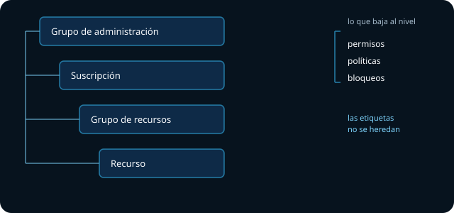

# Fundamentos de Azure

Antes de elegir un servicio hay que entender dónde vive y quién manda sobre él. En Azure todo se construye sobre cuatro piezas: un inquilino que guarda las identidades, una suscripción que paga, un grupo de recursos que ordena y una región que ubica. Quien confunde esas piezas acaba con recursos sueltos, permisos de más y facturas que nadie sabe explicar.

## Inquilino, suscripción y cuenta

El **inquilino** es el directorio de identidades: Microsoft Entra ID, con sus usuarios, grupos y aplicaciones. Es el límite de la identidad, no del gasto. Una misma persona puede existir en varios inquilinos con cuentas distintas, y una organización puede tener un inquilino y varias suscripciones.

La **suscripción** es el límite de la factura y del acceso: los recursos cuelgan de ella, los límites y cuotas se aplican por suscripción y región, y el consumo se mide ahí. Separar suscripciones —por entorno, por equipo o por cliente— separa también el gasto y la superficie de permisos.

La **cuenta** es solo con quién te autenticas. Lo que puede hacer esa cuenta se decide por sus asignaciones de rol, no por su nombre.

## Grupos de recursos

Un **grupo de recursos** es un contenedor lógico con ciclo de vida propio: agrupa lo que se crea, se actualiza y se borra junto. Cada recurso pertenece a un grupo y solo a uno, y no hay grupos dentro de grupos. Los recursos de un grupo pueden estar en regiones distintas.

Dos consecuencias prácticas. La primera: borrar el grupo borra todo lo que contiene, sin preguntar por cada pieza. La segunda: el grupo tiene una ubicación propia donde se guarda su metadato, que no es la ubicación de los recursos.

Mover un recurso entre grupos o entre suscripciones es posible para muchos tipos, pero no para todos, y una mudanza cambia el identificador del recurso. Por eso el grupo se elige al principio y no al final.

## Regiones y zonas

Una **región** es un área geográfica con centros de datos propios. Se elige por cuatro motivos, en este orden: que el servicio que necesitas exista allí, que la latencia al usuario sea aceptable, que la residencia de datos lo permita y que el precio encaje. No todos los servicios están en todas las regiones y no todos los servicios son regionales: algunos son globales por diseño, como la identidad.

Dentro de una región, las **zonas de disponibilidad** son centros de datos separados físicamente. Repartir una carga entre zonas protege de que se caiga un edificio, no de que se caiga la región. Para eso último existen los pares de regiones, pensados para replicar y para coordinar actualizaciones.

## La jerarquía y lo que hereda

```
Grupo de administración
  └── Suscripción
        └── Grupo de recursos
              └── Recurso
```

Los grupos de administración agrupan suscripciones y permiten aplicar una decisión una vez. Sobre esa pirámide viajan tres cosas hacia abajo:

- **Permisos.** Una asignación de rol en un nivel vale para todo lo que cuelga de él.
- **Políticas.** Una directiva asignada arriba se evalúa en los recursos de abajo.
- **Bloqueos.** Un bloqueo en un grupo impide borrar o modificar lo que contiene.

Las **etiquetas** son la excepción: no se heredan por sí solas. Si el coste se imputa por etiqueta, hay que imponerla por política, no confiar en que alguien la escriba.



*Permisos, políticas y bloqueos bajan por la pirámide; las etiquetas no.*

## Control de acceso

Una asignación de rol tiene tres partes: quién, qué y dónde. El **quién** es un usuario, un grupo o una identidad administrada. El **qué** es una definición de rol, con sus acciones permitidas. El **dónde** es el ámbito: grupo de administración, suscripción, grupo de recursos o recurso.

Con eso se toman las decisiones de diseño:

| Decisión | Consecuencia |
|---|---|
| Conceder en la suscripción | Todo lo que se cree después hereda el permiso |
| Conceder a un grupo | El alta y la baja de personas se resuelve en el grupo |
| Conceder a una identidad administrada | La aplicación no guarda credenciales |
| Conceder solo lectura para auditar | El auditor no necesita poder cambiar nada |

Los roles integrados cubren la mayoría de los casos: `Owner` administra todo, incluidos permisos; `Contributor` administra recursos pero no permisos; `Reader` mira. Un rol personalizado se justifica cuando el integrado da demasiado o demasiado poco de forma recurrente.

## Política, bloqueos y coste

**Azure Policy** decide qué se puede desplegar: denegar discos públicos, exigir etiquetas, permitir solo ciertas regiones. Tiene efectos distintos —denegar, auditar, añadir un valor, corregir— y se agrupa en iniciativas. Actúa en el despliegue: una directiva que deniega rechaza la creación igual desde el portal que desde una plantilla, y lo ya desplegado hay que corregirlo aparte.

Los **bloqueos** son la última barrera: `CanNotDelete` y `ReadOnly`. Protegen del borrado accidental, no del malicioso, y actúan sobre el plano de control: bloquear un recurso no cifra sus datos ni impide leerlos por la red.

El **coste** se vigila con presupuestos y análisis de coste sobre la suscripción, y se reparte con etiquetas. Un presupuesto avisa, no corta: para cortar hay que actuar sobre el recurso.

## Nombres

El nombre de un recurso es una decisión técnica, no cosmética. Cada tipo impone longitud, caracteres permitidos y unicidad: algunos exigen unicidad global, otros solo dentro del grupo. Cambiar un nombre suele significar recrear el recurso.

La convención que funciona es la del marco de adopción de la nube: abreviatura del tipo, carga de trabajo, entorno, región e índice. Se implementa como una función que recibe esos datos y devuelve el nombre, no como una cadena escrita a mano en cada plantilla. Y se prueba: un nombre que incumple la regla del tipo falla en el despliegue, no en la revisión.

## Infraestructura como código

El portal sirve para aprender y para mirar, no para construir lo que debe durar. Lo que se despliega con una plantilla —Bicep, ARM o Terraform— queda descrito, se puede revisar y se repite igual en otro entorno.

Bicep es el lenguaje propio de Azure: declara recursos y compila a JSON de ARM. Es declarativo, así que repetir el despliegue converge al mismo estado en lugar de duplicar. Terraform hace lo mismo con su propio lenguaje y guarda el estado en un fichero, que hay que proteger como si fuera código fuente.

La prueba de que el código es la fuente: si alguien cambia algo en el portal y el siguiente despliegue lo deshace, el sistema funciona. Si el cambio sobrevive en silencio, lo que hay desplegado ya no es lo que dice el repositorio.

## Qué revisar antes de seguir

- ¿Cada recurso está en el grupo que le toca por ciclo de vida?
- ¿Los permisos están concedidos en el nivel más bajo que resuelve el caso?
- ¿Las políticas y los bloqueos cubren lo que se crea después, no solo lo que ya existe?
- ¿El nombre se calcula o se escribe a mano?
- ¿Lo desplegado se puede reproducir desde el repositorio?
