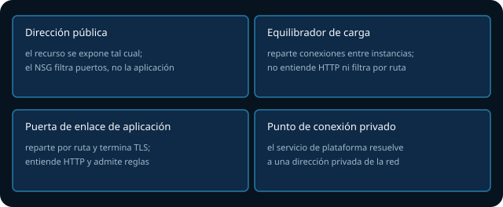

# Red en Azure

Una red virtual es un espacio de direcciones privado donde viven los recursos. Lo que no está dentro no existe para ellos, y lo que está dentro se alcanza sin pedir permiso. Esa comodidad es también el riesgo: la red no separa nada por sí sola, y la separación hay que construirla con reglas.

## Red virtual y subredes

La **red virtual** (VNet) se define con un rango de direcciones privadas, tomado de los rangos reservados para uso interno: `10.0.0.0/8`, `172.16.0.0/12` y `192.168.0.0/16`. Ese rango no se solapa con internet y no se enruta hacia fuera.

Dentro se crean **subredes**, que parten el rango en trozos más pequeños. Cada subred reserva cinco direcciones para uso de la plataforma: la primera y la última del rango, la de puerta de enlace, y dos para DNS. Una subred `/28` tiene dieciséis direcciones y once utilizables; si el cálculo no se hace antes, el reparto se queda corto al crecer.

Por defecto, todos los recursos de una red se ven entre sí, estén en la misma subred o no. Segmentar en subredes ordena y permite aplicar reglas por zona, pero no aísla.

## Grupos de seguridad

Un **grupo de seguridad de red** (NSG) es una lista de reglas con prioridad, origen, destino, puerto y protocolo, y una acción: permitir o denegar. Se puede asociar a una subred o a la tarjeta de un recurso. En una entrada se evalúa primero el de la subred y después el del recurso; en la salida, al contrario.

Las reglas por defecto explican casi todo lo que se ve en un despliegue nuevo:

| Dirección | Prioridad | Regla | Efecto |
|---|---|---|---|
| Entrada | 65000 | Tráfico dentro de la red virtual | Permitido |
| Entrada | 65001 | Equilibrador de carga de Azure | Permitido |
| Entrada | 65500 | Todo lo demás | Denegado |
| Salida | 65000 | Dentro de la red virtual | Permitido |
| Salida | 65001 | Internet | Permitido |
| Salida | 65500 | Todo lo demás | Denegado |

El NSG es **con estado**: si se permite una entrada, la respuesta de vuelta no necesita otra regla. Y no inspecciona contenido: filtra direcciones y puertos, no un `POST` concreto.

La salida es la parte que casi nadie toca. Dejar la salida a internet abierta permite que un recurso comprometido hable con su servidor de mando. Cerrarla obliga a declarar por dónde sale el tráfico legítimo: un cortafuegos, un NAT o un proxy.

## Publicar un servicio

Para que algo de dentro sea alcanzable desde fuera hay varias formas, y no son equivalentes:

- **Dirección IP pública** en el recurso. Es la más rápida y la que peor envejece: expone el recurso directamente y el grupo de seguridad filtra puertos, no la aplicación.
- **Equilibrador de carga**. Reparte conexiones entre instancias del mismo servicio. Trabaja en la capa de red: no entiende HTTP ni termina TLS.
- **Puerta de enlace de aplicación**. Entiende HTTP, reparte por ruta y termina TLS, de modo que puede aplicar reglas sobre la URL.
- **Punto de conexión privado**. Publica un servicio de plataforma dentro de la red, con una dirección privada, para que no haya que atravesar internet.

La administración no es una forma de publicar. Para eso está **Bastion**, que da acceso por el portal sin abrir el puerto de administración a internet.

El punto de conexión privado es el que cambia el diseño: una base de datos o una cuenta de almacenamiento se alcanzan por su nombre, pero resuelven a una dirección privada. Para que eso funcione, el DNS tiene que estar bien: la zona privada se enlaza a la red y el nombre público resuelve dentro.

## Varias redes

Dos redes se conectan con **emparejamiento** (*peering*), que no es transitivo: si A está emparejada con B y B con C, A no ve C. Esa limitación es la que empuja al diseño en estrella, con una red central que hace de concentrador y redes satélite para cada carga.

En el concentrador viven el cortafuegos, la salida a internet y los servicios compartidos. Las satélite se conectan a él. Todo el tráfico entre satélite y satélite pasa por el concentrador, y ahí es donde se inspecciona y se registra.

El emparejamiento se crea en los dos sentidos y pide permisos en cada lado. Lo que no hace es transitar: si A está emparejada con B y B con C, el tráfico de A no llega a C por esa cadena.

## Nombres y resolución

Azure ofrece resolución de nombres dentro de la red, suficiente para recursos del mismo dominio. Para nombres propios, zonas privadas y servicios publicados por enlace privado, se usan **zonas DNS privadas** enlazadas a una o varias redes.

El fallo típico: el punto de conexión privado existe, pero la zona no está enlazada a la red donde está el cliente, así que el nombre sigue resolviendo a la dirección pública. El servicio parece roto y el recurso está bien.

*Cuatro formas de publicar; solo la última evita que el tráfico cruce internet.*

## Qué revisar

- ¿Hay direcciones públicas que no deberían existir?
- ¿La salida está filtrada o sale todo por internet?
- ¿El NSG filtra también la salida, o solo la entrada?
- ¿El reparto de subredes aguanta el crecimiento previsto?
- ¿Los puntos de conexión privados resuelven por DNS privado en todas las redes que los usan?
- ¿El emparejamiento cubre los dos sentidos y no se asume transitividad?
