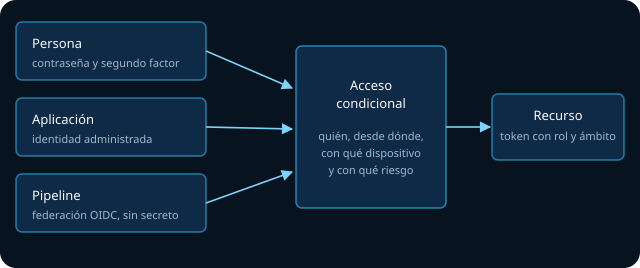

# Identidad en Azure

Una persona, una aplicación y un pipeline son tres tipos de identidad y los tres necesitan autenticarse y autorizarse. En Azure eso lo resuelve Microsoft Entra ID: un directorio donde viven las identidades y las políticas que deciden quién pasa. La red filtra direcciones; la identidad decide personas.

## Qué es y qué no es

Entra ID es un servicio de directorio en la nube. Habla SAML, OpenID Connect, OAuth 2.0 y WS-Federation, y no ofrece LDAP ni Kerberos como un controlador de dominio. Un Active Directory local se conecta a él con sincronización y, si hace falta, con federación, pero no son el mismo sistema.

La distinción importa al diseñar. Un permiso en Azure no es un permiso en el directorio: los papeles de directorio administran el propio Entra ID, y los roles de control de acceso administran recursos de Azure. Son dos sistemas con dos listas, y una cuenta con el papel de administrador global no puede leer una suscripción hasta que se le concede acceso o se eleva el suyo de forma temporal.

## Cuentas y grupos

Las cuentas pueden ser **miembro** del directorio o **invitadas** de otro. Una cuenta invitada conserva sus credenciales de origen y se autentica en su directorio, no en el tuyo.

Los **grupos** son la unidad de asignación: se concede a grupos, no a personas. Dos clases conviene distinguirlas: los de seguridad, que se usan para permisos, y los de Microsoft 365, que además agrupan correo y recursos de colaboración. La pertenencia puede ser asignada a mano o calculada con una regla sobre atributos —departamento, puesto, ubicación—, y esa regla es la que evita que la baja de una persona dependa de que alguien se acuerde.

## Autenticación

La autenticación se compone de métodos y de políticas. Los métodos van del más débil al más fuerte: contraseña, código por aplicación, llamada, llave física. La política decide qué método exige cada caso.

El motor de esa decisión es el **acceso condicional**: un conjunto de reglas que evalúan señales —quién es, desde dónde, con qué dispositivo, a qué aplicación, con qué riesgo— y aplican una consecuencia: exigir segundo factor, bloquear, pedir un dispositivo administrado o limitar la sesión. Empieza por las reglas de bloqueo y sigue por exigir MFA a los administradores; el resto se añade por riesgo y por aplicación.

El acceso sin contraseña se apoya en llaves físicas, en la aplicación de autenticación o en el propio dispositivo. Es más seguro y menos costoso de soportar, pero solo funciona si hay un plan de recuperación: sin él, perder el móvil significa perder la cuenta.

## Identidades de aplicación

Una aplicación necesita identificarse ante Azure, y hay tres formas:

| Forma | Qué es | Cuándo |
|---|---|---|
| Identidad administrada asignada por el sistema | La crea Azure con el recurso y muere con él | Un recurso que habla con otro servicio de Azure |
| Identidad administrada asignada por el usuario | Objeto propio, se asigna a varios recursos | Varios recursos comparten permisos |
| Entidad de servicio con federación | Confianza en un emisor externo por OIDC, sin secreto | Un pipeline de fuera de Azure |

*Tres identidades, una puerta: la política decide con qué señales y el token lleva el rol.*

La regla es sencilla: **ninguna credencial guardada**. Una identidad administrada no tiene contraseña que rotar ni secreto que filtrar. Cuando la integración es externa, la federación de identidad de carga de trabajo sustituye al secreto por un token de corta duración emitido por el proveedor.

Un registro de aplicación, en cambio, es la definición de una aplicación: sus permisos, sus URI de redirección y sus credenciales. Si acaba con un secreto, ese secreto caduca, se copia y se comparte; se pone fecha y se rota, o se migra a federación.

## Privilegio mínimo

El diseño de permisos tiene tres piezas que se complementan:

- **Asignaciones permanentes mínimas.** El día a día con lo justo; el resto, bajo petición.
- **Elevación temporal.** El rol se activa por horas, con motivo, aprobación y MFA. Requiere licencia superior.
- **Revisiones de acceso.** Cada cierto tiempo, alguien confirma que un permiso sigue teniendo sentido.

A eso se añade la separación de funciones: quien administra la identidad no debería administrar también las cargas, y quien aprueba un acceso no debería ser quien lo concede.

## Vigilancia de la identidad

Los registros de inicio de sesión y de auditoría del directorio son la fuente principal. Se conservan pocos días en el directorio según licencia, así que se exportan a un área de trabajo para conservarlos y consultarlos junto al resto de la telemetría.

Sobre esos datos se vigilan cuatro señales: intentos fallidos repetidos seguidos de un acierto, inicios desde ubicaciones imposibles, cuentas de servicio usadas desde fuera de su horario y activaciones de rol fuera de lo previsto. La detección de riesgo del propio directorio ayuda, pero no sustituye a una consulta propia que conozca el entorno.

## Qué revisar

- ¿Hay cuentas sin MFA o con métodos débiles habilitados?
- ¿Los permisos se dan a grupos o a personas?
- ¿Queda algún administrador global permanente?
- ¿Las aplicaciones guardan secretos donde no deberían?
- ¿Las bajas se resuelven en el directorio o en una lista paralela?
- ¿Los registros de inicio de sesión se conservan fuera del directorio?
