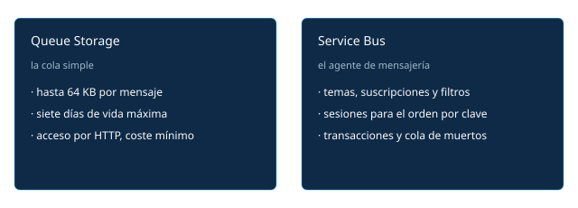

# Bus de mensajería

Un bus de mensajería desacopla a quien produce un mensaje de quien lo consume: el emisor publica y el receptor procesa cuando puede, sin que ninguno tenga que estar disponible a la vez. Esa separación absorbe los picos de carga, permite reintentar lo que falla y deja añadir consumidores sin tocar al productor.

## Cola o tema

En una cola, cada mensaje lo procesa un solo consumidor: es la forma de repartir trabajo. En un tema, cada mensaje llega a todas las suscripciones interesadas, cada una con su propia copia y su propio ritmo: es la forma de anunciar un hecho. Elegir mal entre las dos es el error más común al empezar.

## Las dos piezas de Azure

Azure Queue Storage es la opción simple: mensajes de hasta 64 KB, siete días de vida máxima y acceso por HTTP. Sirve cuando el requisito es encolar tareas y que alguien las haga.

Azure Service Bus añade lo que un sistema con reglas de negocio termina necesitando: temas con suscripciones y filtros, sesiones para mantener el orden por clave, transacciones, detección de duplicados y una cola de mensajes muertos donde mirar lo que no se pudo procesar.

*La cola simple encola trabajo; el bus añade temas, orden por clave y cola de mensajes muertos.*

## Lo que sostiene el sistema

La entrega es de al menos una vez, así que el consumidor tiene que ser idempotente: recibir dos veces el mismo mensaje no puede producir dos efectos. Y una cola de mensajes muertos sin nadie leyéndola pierde mensajes en silencio, por muy bien configurado que esté el resto.
