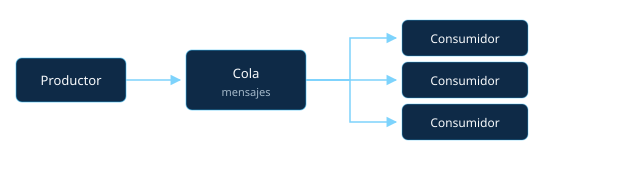
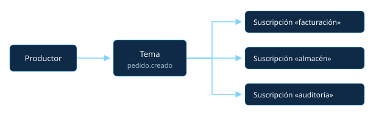
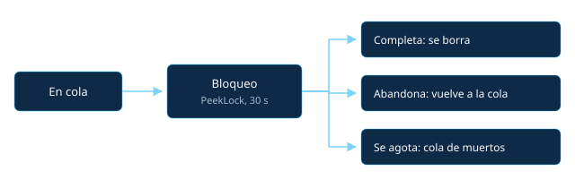

# Bus de mensajería

Un bus de mensajería separa a quien produce un mensaje de quien lo consume. El emisor publica y sigue con lo suyo; el receptor lo procesa cuando puede, a su ritmo. Ninguno de los dos necesita estar disponible en el mismo instante, y ninguno tiene que conocer la dirección del otro.

Esa separación resuelve tres problemas que aparecen pronto en cualquier sistema: los picos de carga, porque la cola absorbe el exceso mientras el consumidor termina lo anterior; los fallos parciales, porque un mensaje que no se pudo procesar se reintenta en lugar de perderse; y el acoplamiento, porque añadir un consumidor nuevo no obliga a tocar al productor.

## Cola o tema

Hay dos formas de repartir un mensaje, y elegir mal es el error más común.

En una **cola**, cada mensaje lo procesa un solo consumidor. Si hay cinco instancias leyendo la misma cola, cada mensaje va a una de ellas: es la forma natural de repartir trabajo.



*Cada mensaje va a un consumidor; tres instancias se reparten el trabajo.*

En un **tema**, cada mensaje llega a todas las suscripciones interesadas. Cada suscripción mantiene su propia copia y su propio ritmo, de modo que un servicio puede ir por detrás sin frenar a los demás. Es la forma natural de anunciar un hecho.



*Cada suscripción recibe su copia y marca su ritmo; el emisor no sabe quién escucha.*

## Azure Queue Storage

La opción más simple de Azure para encolar trabajo. Guarda los mensajes en una cuenta de almacenamiento y se accede a ellos por HTTP o HTTPS con una URL con esta forma:

```text
https://<cuenta>.queue.core.windows.net/<cola>
```

Cada mensaje admite hasta 64 KB y puede permanecer en la cola un máximo de siete días. Una cola puede contener millones de mensajes, hasta el límite de capacidad de la cuenta de almacenamiento.

El modelo de entrega es de *al menos una vez*: al leer un mensaje, este queda invisible durante un tiempo y, si el consumidor no lo borra antes de que ese plazo expire, vuelve a estar disponible. El consumidor debe ser idempotente, porque el mismo mensaje puede llegar dos veces.

Es la elección razonable cuando el requisito es «encolar tareas y que alguien las haga» y no hace falta orden, transacciones ni enrutado por contenido.

## Azure Service Bus

Service Bus es un agente de mensajería empresarial completamente administrado. Añade a la cola simple lo que un sistema con reglas de negocio termina necesitando: temas con suscripciones, filtros, sesiones, transacciones y una cola de mensajes muertos.

### Colas, temas y suscripciones

Una cola de Service Bus funciona como la de almacenamiento, pero con más garantías: admite recepción con bloqueo (*PeekLock*) o recepción y borrado (*ReceiveAndDelete*), detección de duplicados y entrega diferida.

Un tema reparte cada mensaje entre sus suscripciones. Cada suscripción puede filtrar por propiedades del mensaje o por su cuerpo, de modo que un servicio recibe solo lo que le concierne sin que el emisor sepa quién escucha:

```text
pedido.creado  ->  suscripción "facturacion"  (importe > 100)
               ->  suscripción "almacen"
               ->  suscripción "auditoria"    (todas)
```

### Entrega y errores

El consumidor recibe el mensaje con un bloqueo temporal. Mientras lo tiene, nadie más lo ve. Si termina bien, lo completa; si falla, lo abandona y vuelve a la cola; si lo aplaza, queda disponible para más tarde.



*Mientras dura el bloqueo nadie más ve el mensaje; si se agotan los intentos, va a la cola de mensajes muertos.*

Cuando un mensaje supera el número de entregas permitido, Service Bus lo mueve a la **cola de mensajes muertos**. Esa cola no es un contenedor de basura: es el sitio donde se mira qué está fallando. Un sistema sin nadie leyendo la cola de muertos pierde mensajes en silencio.

### Orden y sesiones

Las colas y los temas no garantizan el orden entre mensajes distintos. Cuando el orden importa —una secuencia de movimientos de una misma cuenta, por ejemplo— se usan **sesiones**: los mensajes que comparten un identificador de sesión se entregan en orden y a un solo consumidor a la vez.

## Cuándo usar cada uno

| Necesidad | Queue Storage | Service Bus |
|---|---|---|
| Encolar tareas simples | Sí | Sí, con más coste |
| Repartir un mensaje entre varios servicios | No | Sí, con temas |
| Filtrar por contenido | No | Sí |
| Orden estricto por clave | No | Sí, con sesiones |
| Transacciones entre operaciones | No | Sí |
| Coste mínimo | Sí | No |

La regla práctica: si el mensaje solo tiene que llegar, Queue Storage; si además tiene que llegar a alguien concreto, en un orden concreto y con garantías, Service Bus.

## Un ejemplo con el SDK .NET

El paquete `Azure.Messaging.ServiceBus` trabaja con un cliente que se crea una vez y se reutiliza. Enviar es una llamada:

```csharp
await using var cliente = new ServiceBusClient(cadenaDeConexion);
ServiceBusSender emisor = cliente.CreateSender("pedidos");

var pedido = new Pedido(1042, 250.00m);
await emisor.SendMessageAsync(
    new ServiceBusMessage(JsonSerializer.Serialize(pedido))
    {
        Subject = "pedido.creado",
        ContentType = "application/json"
    });
```

Recibir con un procesador deja el ciclo de vida en manos del SDK: él bloquea, entrega, reintenta y completa.

```csharp
ServiceBusProcessor procesador = cliente.CreateProcessor("pedidos");

procesador.ProcessMessageAsync += async args =>
{
    var pedido = JsonSerializer.Deserialize<Pedido>(args.Message.Body.ToString());
    await GuardarAsync(pedido);
    await args.CompleteMessageAsync(args.Message);
};

procesador.ProcessErrorAsync += args =>
{
    logger.LogError(args.Exception, "Fallo al procesar");
    return Task.CompletedTask;
};

await procesador.StartProcessingAsync();
```

El cliente, el emisor y el procesador son objetos de vida larga: se crean al arrancar y se cierran al parar. Crear uno por mensaje agota las conexiones.

## Lo que conviene vigilar

- **Mensajes en la cola de muertos.** Debería ser cero, o tener una explicación. Es la primera métrica que se mira cuando algo no llega.
- **Antigüedad del mensaje más viejo.** Una cola que crece sin consumirse se ve aquí antes que en ningún otro sitio.
- **Reintentos por mensaje.** Un mensaje que se reintenta en bucle suele ser un fallo de código, no de red.
- **Idempotencia del consumidor.** Con entrega de al menos una vez, procesar dos veces el mismo mensaje tiene que dar el mismo resultado.
