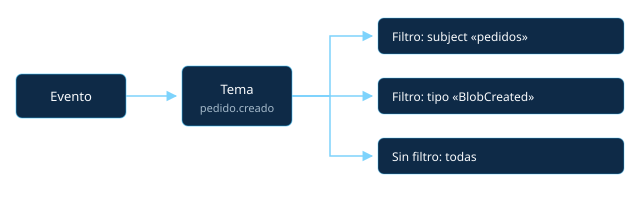
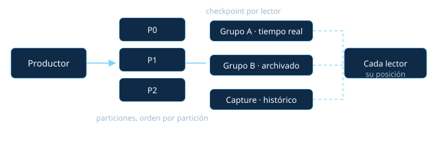

# Servicios orientados a eventos

Un servicio orientado a eventos reacciona a lo que pasa en lugar de preguntar por el estado. Algo ocurre —se crea un archivo, cambia un recurso, entra una lectura—, se publica un evento y cada servicio interesado actúa. Nadie consulta cada segundo si hay novedades.

La diferencia con la mensajería es de intención. Un mensaje pide que se haga algo; un evento anuncia que algo ha pasado. El emisor de un evento no sabe quién lo escucha ni espera respuesta, y quien lo escucha decide qué hacer con él.

## Evento, comando y mensaje

Confundir los tres lleva a diseñar mal el sistema:

- Un **comando** es una orden dirigida a un destinatario concreto y espera un efecto: `EnviarFactura`.
- Un **mensaje** es la unidad que viaja por una cola o un bus; puede transportar un comando o un evento.
- Un **evento** es un hecho ocurrido, en pasado y sin destinatario: `PedidoCreado`.

Un evento se nombra en pasado porque no se puede rechazar. Si un servicio no está interesado, se da de baja; no devuelve un error.

## Event Grid

Event Grid distribuye eventos discretos. Su trabajo es entregar una notificación pequeña a los servicios suscritos, rápido y con reintentos.

### Publicación y suscripción

Un **tema** es el punto donde se publican los eventos. Una **suscripción** es la regla que dice a dónde van: una función, una cola, un webhook, un centro de eventos. Un mismo evento puede tener varias suscripciones y cada una recibe su copia.



*Un evento, tres suscripciones: cada una filtra lo que le concierne.*

Azure publica también eventos de su propia plataforma —un recurso creado, una máquina virtual encendida— a través de temas del sistema, sin que el usuario tenga que publicar nada.

### Filtros y entrega

Una suscripción puede filtrar por tipo de evento, por asunto o por propiedades del cuerpo. Así, un servicio que solo atiende pedidos no recibe el resto del tráfico:

```json
{
  "filter": {
    "subjectBeginsWith": "/suscripciones/tienda/pedidos/",
    "includedEventTypes": ["Microsoft.Storage.BlobCreated"]
  }
}
```

La entrega es de *al menos una vez*, con reintentos y retroceso exponencial. Si el destino sigue sin responder, el evento puede acabar en una cuenta de almacenamiento configurada como destino de mensajes muertos. El consumidor, otra vez, tiene que ser idempotente.

### CloudEvents

Event Grid habla CloudEvents 1.0, un formato estándar que permite publicar en otros proveedores sin reescribir el emisor. Un evento tiene este aspecto:

```json
{
  "specversion": "1.0",
  "type": "tienda.pedido.creado",
  "source": "/tienda/pedidos",
  "subject": "pedido/1042",
  "id": "9f1c2a7e-4d3b-4f0a-9c1e-27a6b0f4d8c1",
  "time": "2026-11-17T10:15:00Z",
  "datacontenttype": "application/json",
  "data": { "pedido": 1042, "importe": 250.0 }
}
```

El `id` es lo que permite descartar duplicados y `time` lo que permite ordenar sin fiarse del orden de llegada.

## Event Hubs

Event Hubs ingiere flujos: muchos eventos por segundo, en orden dentro de cada partición, y los deja disponibles para que uno o varios consumidores los lean por su cuenta.

### Particiones y grupos de consumidores

Un centro de eventos se divide en **particiones**. Los eventos se reparten entre ellas y cada partición mantiene su orden. El número de particiones se fija al crearlo y marca el paralelismo máximo de lectura.

Un **grupo de consumidores** es una vista independiente del flujo. Dos grupos leen los mismos eventos sin quitarse nada el uno al otro: uno puede alimentar el análisis en tiempo real y otro el archivado.



*Cada grupo guarda su posición: leer el flujo dos veces no quita eventos al otro.*

La lectura es de tipo *pull*: el consumidor pide y avanza guardando su posición (*checkpoint*). Si se cae, retoma desde el último punto guardado; por eso el checkpoint se escribe cada cierto número de eventos y no en cada uno.

### Capture y Kafka

**Capture** copia el flujo tal cual a almacenamiento en ventanas de tiempo o de tamaño, sin escribir código: es la forma barata de tener el histórico en bruto.

Event Hubs expone además un punto de entrada compatible con Kafka, de modo que una aplicación escrita para Kafka puede publicar y consumir sin cambiar el cliente.

## Cuándo usar cada uno

| Necesidad | Event Grid | Event Hubs |
|---|---|---|
| Avisar de que algo pasó | Sí | No es su fin |
| Enrutar por tipo o asunto | Sí | No |
| Millones de eventos por segundo | No | Sí |
| Leer el flujo varias veces | No | Sí, con grupos |
| Guardar el histórico en bruto | No | Sí, con Capture |

La regla práctica: Event Grid para reaccionar a hechos puntuales; Event Hubs para procesar un torrente continuo.

## Lo que conviene vigilar

- **Eventos sin entregar.** Event Grid reintenta, pero un destino caído durante horas termina en mensajes muertos.
- **Retraso por partición.** En Event Hubs, el retraso del consumidor respecto a la punta del flujo dice si el procesamiento va por detrás.
- **Reparto entre particiones.** Una clave de partición mal elegida concentra todo el tráfico en una y deja las demás vacías.
- **Tamaño del evento.** Un evento es una notificación, no un documento: si lleva el objeto entero, conviene plantearse si es un evento o un mensaje.
