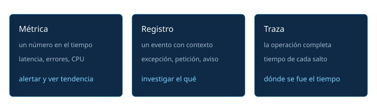
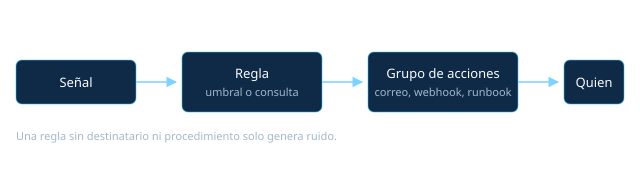

# Monitorización

Monitorizar es medir lo que hace el sistema para saber si cumple su función antes de que el fallo lo note el usuario. Sin medida, un problema se descubre por una queja; con medida, se descubre por una gráfica que se sale de lo normal.

La monitorización no es una pantalla con gráficas: es un conjunto de preguntas con respuesta. ¿Cuánto tarda la API en responder? ¿Cuántas peticiones fallan y por qué? ¿Qué cambió a la misma hora en que empeoró el servicio?

## Métricas, registros y trazas

Las tres piezas miden cosas distintas y se usan para cosas distintas:

- Una **métrica** es un número en el tiempo: latencia, número de peticiones, uso de CPU, memoria. Es barata de guardar y de consultar, y sirve para ver tendencias y disparar alertas.
- Un **registro** es un evento con texto y contexto: una excepción, una petición con su código de estado, un mensaje de arranque. Es caro de guardar, pero es lo que explica el qué y el por qué.
- Una **traza** sigue una operación completa por varios servicios, con el tiempo de cada salto. Es lo que permite decir en qué punto de la cadena se fue el tiempo.

La regla práctica: alertar sobre métricas, investigar con registros y trazas.



*Tres señales, tres usos: alertar, investigar y localizar el salto que falló.*

## Azure Monitor

Azure Monitor recoge los tres tipos de datos de los recursos de Azure y de las aplicaciones que corren en ellos, los guarda y permite consultarlos y actuar sobre ellos.

### Métricas de plataforma

Cada recurso publica métricas sin configurar nada: peticiones, latencia de respuesta, errores, conexiones, consumo. Se retienen por un periodo corto y se consultan por recurso. Sirven para paneles y para alertas rápidas.

Algunas métricas se pueden enriquecer con **métricas personalizadas**: la aplicación publica un número propio —pedidos procesados, artículos en cola— y se consulta igual que las demás.

### Registros y el área de trabajo

Los registros de los recursos se envían a un **área de trabajo de Log Analytics**, un almacén con su propia configuración y su propio control de acceso. Allí se mezclan datos de varios recursos y se consultan juntos, que es lo que permite cruzar la caída de una API con un cambio en la base de datos.

La retención se configura por área de trabajo. Pasado ese tiempo, el detalle se pierde; si hace falta conservarlo más, se archiva o se exporta.

### Alertas

Una alerta es una regla sobre una señal. Puede vigilar una métrica —la latencia media supera un umbral— o el resultado de una consulta de registros —aparecen más de diez errores 500 en cinco minutos—. Cuando se cumple, dispara una acción: un correo, un webhook, una función, un runbook.

La parte que casi nadie configura y es la que importa: **el grupo de acciones**. Una alerta sin destinatario y sin procedimiento solo genera ruido.



*La regla detecta; sin grupo de acciones y sin procedimiento, no llega a nadie.*

## KQL en cinco minutos

KQL (*Kusto Query Language*) es el lenguaje de consulta del área de trabajo. Es de solo lectura y se lee de izquierda a derecha: primero la tabla, luego los filtros y por último la forma del resultado.

```kql
requests
| where timestamp > ago(1h)
| summarize p95 = percentile(duration, 95),
            fallos = countif(success == false)
        by name
| order by p95 desc
```

Esa consulta devuelve, por operación, el percentil 95 de duración y cuántas peticiones fallaron en la última hora. Tres operadores bastan para empezar: `where` filtra, `summarize` agrupa y `order by` ordena.

El percentil 95 dice más que la media: si el 95 % de las peticiones tarda menos de 300 ms, el 5 % restante es lo que sufre la gente.

## Application Insights

Application Insights mide desde dentro de la aplicación. Con el SDK o con una instrumentación automática, recoge:

- **Peticiones**: cada entrada a la aplicación, con duración y código de respuesta.
- **Dependencias**: las llamadas salientes —base de datos, HTTP, colas— con su duración y su fallo.
- **Excepciones**: con la pila y el contexto de la operación.
- **Trazas**: los mensajes que escribe la aplicación.
- **Operaciones**: la unión de todo lo anterior bajo un mismo identificador, que es lo que da la traza distribuida.

El **muestreo** descarta un porcentaje de la telemetría cuando hay mucho volumen. Es necesario para no pagar por cada petición, pero cambia la lectura de los números: con muestreo, un recuento es una estimación, no una cifra exacta.

## Optimización de coste

El coste de Azure se reduce con cuatro palancas, y cada una se mide distinto:

| Palanca | Qué cambia | Qué se mide |
|---|---|---|
| Tamaño | Ajustar la SKU a la carga real | CPU y memoria usadas frente a reservadas |
| Escalado | Añadir y quitar instancias según la demanda | Instancias mínimas y picos cubiertos |
| Compromiso | Reserva o plan de ahorro a uno o tres años | Porcentaje de uso cubierto por compromiso |
| Apagado | Parar lo que no se usa fuera de horario | Horas encendidas frente a horas facturadas |

Ajustar el tamaño sin medir es adivinar. Se mira el percentil 95 de CPU y memoria durante dos semanas; si no pasa del 30 %, la SKU sobra. El escalado automático no sustituye al ajuste: una regla sobre una instancia sobredimensionada sigue pagando de más en el mínimo.

El compromiso se aplica a lo que se sabe que va a seguir encendido. Un plan de ahorro cubre un gasto por hora y no un recurso concreto, así que sirve para cargas que cambian de tamaño. Reservar una máquina que se apaga en dos meses es atar dinero.

## Advisor

Azure Advisor revisa los recursos y propone mejoras en cinco frentes: coste, seguridad, fiabilidad, rendimiento y excelencia operativa. Cada recomendación trae el impacto estimado y el recurso afectado; el panel ordena por impacto para que no se pierda el tiempo en lo pequeño.

No se aplica a ciegas. Una recomendación de eliminar un recurso sin usar puede referirse a algo que se enciende en campaña; una de seguridad puede romper una integración. Se lee el motivo, se comprueba el recurso y se decide.

La **puntuación de Advisor** es un resumen, no un objetivo. Subirla sin entender qué cambia es la forma más rápida de romper algo para mejorar una cifra.

## Presupuesto y alertas de coste

Un presupuesto es una regla sobre el gasto de una suscripción o un grupo de recursos. No corta el servicio: avisa al llegar a un porcentaje. Los umbrales habituales son el 50, el 80 y el 100 % del importe previsto.

La alerta necesita un destinatario y una primera acción, igual que una alerta de disponibilidad. Un presupuesto que avisa a un buzón que nadie mira no evita la factura.

Para saber qué gasta, se etiquetan los recursos por servicio, entorno y propietario, y se impone la etiqueta por política. Sin etiqueta, el desglose se queda en “varios” y no hay forma de imputar el coste.

## Qué medir y qué no

Cuatro señales cubren la mayoría de los incidentes:

| Señal | Pregunta | Ejemplo |
|---|---|---|
| Latencia | ¿Cuánto tarda? | Percentil 95 de las peticiones |
| Tráfico | ¿Cuánto recibe? | Peticiones por segundo |
| Errores | ¿Cuántas fallan? | Proporción de respuestas 5xx |
| Saturación | ¿Qué está al límite? | CPU, conexiones, longitud de cola |

Lo que no conviene: alertar de todo lo que se puede medir. Una alerta que salta cada semana y siempre se ignora enseña al equipo a ignorar las alertas. Cada una debería tener un umbral justificado, un destinatario y una primera acción escrita.
