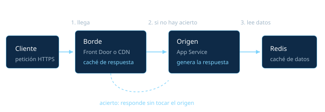

# Caché y entrega de contenido

Una caché acierta cuando la copia sigue siendo válida y falla cuando ya no lo es. El diseño empieza por decidir cuánto puede envejecer un dato y cómo se avisa cuando cambia. Todo lo demás —el producto, el tamaño, la región— se elige después.

## Caducar no es invalidar

**Caducar** es dejar que una copia expire sola al cumplir su tiempo de vida, el TTL. **Invalidar** es retirarla antes de que expire porque el dato cambió. Lo primero es barato y no necesita coordinación; lo segundo exige saber qué copias existen y dónde.

Un catálogo de productos tolera un TTL de cinco minutos: un precio actualizado tarde no rompe nada. El precio de una compra no lo tolera: entre ver el importe y pagar no puede haber dos valores. La misma aplicación puede usar las dos políticas según la pantalla.

## TTL y caso concreto

Cada clave de Redis se guarda con una caducidad:

```csharp
var opciones = new DistributedCacheEntryOptions
{
    AbsoluteExpirationRelativeToNow = TimeSpan.FromMinutes(5),
    SlidingExpiration = TimeSpan.FromMinutes(1)
};
await cache.SetStringAsync($"producto:{id}", json, opciones);
```

`AbsoluteExpirationRelativeToNow` fija el límite duro: a los cinco minutos, la clave desaparece aunque se lea. `SlidingExpiration` renueva el plazo mientras hay actividad, pero nunca más allá del absoluto. Sin el absoluto, una clave muy consultada no caduca nunca.

Cuando el precio cambia, no se espera a que caduque: se borra la clave del producto y la siguiente petición la reconstruye. Si el cambio afecta a una lista, se borran las claves de la lista y de cada producto que contenía. Una invalidación incompleta deja copias viejas conviviendo con la nueva.

## Redis

Azure Cache for Redis, y su sucesor Azure Managed Redis, ofrecen el almacén compartido que falta entre instancias. Lo habitual es usarlo para cuatro cosas: caché de datos, estado de sesión, contadores y bloqueos distribuidos.

No es una base de datos. El desalojo por memoria puede borrar claves antes de su TTL, y una configuración sin réplica pierde lo que tenga dentro. Lo que no se puede reconstruir no va a Redis.

La conexión se hace con `IDistributedCache` o con el cliente de StackExchange.Redis cuando hace falta algo que la abstracción no cubre, como operaciones atómicas o pub/sub. La cadena de conexión va en Key Vault o en una identidad administrada, nunca en `appsettings.json` versionado.

## CDN

La CDN sirve archivos estáticos desde el nodo más cercano: imágenes, hojas de estilo, scripts y descargas. El origen solo recibe la primera petición de cada nodo y las siguientes se resuelven en el borde.

El TTL se declara en la respuesta con `Cache-Control`. Un archivo con nombre versionado, como `app.3f2a1c.css`, puede llevar un año: si cambia, cambia el nombre. Un documento HTML que no lleva versión en la ruta necesita un TTL corto o purga explícita.

La purga se pide por URL y tarda en propagarse. Por eso se prefiere el nombre versionado: no hay purga que esperar, porque la URL nueva no está cacheada.

## Front Door

Front Door es la entrada global: recibe la petición en el nodo más cercano, aplica WAF y enrutado, y la manda al origen sano de la región elegida. También puede cachear la respuesta y servirla sin llegar al origen.

Sus dos decisiones son el enrutado y la salud. El enrutado reparte por ruta, por región o por prioridad. La salud consulta un endpoint periódicamente y retira del reparto al origen que falla. Un health check mal configurado retira un origen sano o mantiene uno roto; conviene que compruebe lo mismo que necesita la aplicación, no solo que el puerto responda.

## El camino completo



*El borde responde si tiene una copia válida; si no, el origen la genera y lee los datos de Redis.*

La petición llega al borde. Si la respuesta está cacheada y vigente, vuelve sin tocar el origen. Si no, el origen la genera, consulta Redis para los datos que no quiere recalcular y devuelve el resultado, que el borde guarda con su TTL.

Cada salto tiene su propia caducidad. El borde puede servir una respuesta de hace un minuto construida con datos de Redis de hace cuatro. Si esa suma no es aceptable, la respuesta no se cachea en el borde y se resuelve en el origen.

## Qué se mide

Un acierto se mide por separado en cada capa: porcentaje de aciertos del borde, del origen contra Redis y tiempo de la consulta que se evitó. Sin esas tres cifras no se sabe si la caché ahorra o solo añade un componente que fallar.

Una caché con un porcentaje de aciertos bajo es peor que no tenerla: paga la consulta, el viaje y la gestión. Antes de añadir otra capa, se mide la que ya existe.
