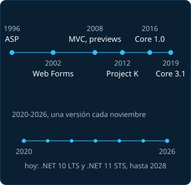

# Historia de ASP.NET Core MVC

ASP.NET Core no es una versión más de ASP.NET: es una reescritura. Entender qué se dejó atrás explica por qué una aplicación web en .NET se escribe hoy con middleware, inyección de dependencias y despliegue en Linux, y por qué el camino tuvo dos intentos: uno que funcionó y envejeció, y otro que empezó de cero.

La línea temporal resume el recorrido —los hitos hasta 2019 arriba y el tramo de 2020 a hoy abajo— antes de entrar en cada parte.

*De las páginas dinámicas de 1996 a .NET 11 en 2026: cada hito cambia la forma de escribir la aplicación.*

## Páginas dinámicas y Web Forms

Active Server Pages llegó a finales de 1996. Mezclaba HTML y VBScript en el servidor para generar la página en cada petición, y durante años fue una opción razonable: todavía hoy hay sitios que funcionan sobre ella.

En 2002, Microsoft presentó ASP.NET 1.0 dentro de .NET. La plataforma ofrecía un *runtime* gestionado, orientación a objetos y varios lenguajes, con C# y Visual Basic .NET como opciones principales. Sobre esa base construyó Web Forms.

Web Forms prometía algo atractivo para quien venía del escritorio: controles visuales, eventos, arrastrar y soltar, y el estado de la página conservado entre peticiones. Se programaba casi como una aplicación de ventanas, sin tocar HTML ni JavaScript.

El precio era una capa de abstracción sobre la web. El desarrollador dejaba de decidir qué marcado llegaba al navegador y dependía del *framework* para el estado y el AJAX. Durante un tiempo compensó; cuando la web cambió, empezó a pesar.

## El desencuentro con la web

La comunidad puso el foco en los estándares, en un HTML semántico y ligero, en AJAX y en aplicaciones cada vez más grandes que exigían escalabilidad y pruebas. Frameworks como Ruby on Rails mostraron que se podía escribir web de otra manera, más cerca del protocolo y del marcado.

Microsoft reaccionó. Las primeras *previews* de ASP.NET MVC, hacia 2008, ofrecían control total sobre el HTML enviado, URLs amigables, integración natural con AJAX y una estructura fácil de probar. La adopción no fue inmediata, porque el cambio respecto a Web Forms era grande, pero en pocos años MVC se convirtió en la opción recomendada para web en .NET.

A MVC le siguieron Web API, para servicios HTTP, y SignalR, para tiempo real. Los tres compartían un problema de fondo: se apoyaban en el ASP.NET clásico, una base sólida a la que ya le pesaban los años.

## El reinicio: ASP.NET Core

En 2012, Microsoft concluyó que la infraestructura de 2002 había llegado a su límite y empezó otra línea desde cero. El proyecto, conocido primero como «Project K», pasó por los nombres ASP.NET vNext y ASP.NET 5 antes de quedarse en ASP.NET Core 1.0, para dejar claro que era un producto nuevo.

Los objetivos eran modularidad, orientación a la nube, rendimiento y escalado, multiplataforma real y código abierto. Sobre esa base se reescribió MVC, que dio lugar a ASP.NET Core MVC: un *framework* nuevo por dentro que conservaba lo que ya funcionaba del MVC clásico.

Tras las betas y las versiones candidatas, ASP.NET Core 1.0 se publicó a comienzos del verano de 2016. Llegó con carencias, y la comunidad las encontró usando el producto en pruebas y proyectos reales. Ese retorno alimentó la versión siguiente.

## De 1.0 a 3.1

ASP.NET Core 2.0, algo más de un año después, mejoró características, estabilidad, rendimiento y soporte. La 2.1 llegó en mayo de 2018 con cambios internos que dispararon el rendimiento, y la 2.2, a finales de ese año, siguió la misma dirección.

En septiembre de 2019 apareció la 3.0, con mejoras internas, funciones nuevas y otro salto de rendimiento. En diciembre, la 3.1 añadió correcciones y la convirtió en LTS, con tres años de soporte oficial que terminaron en diciembre de 2022. Fue la versión de referencia durante años; su modelo de arranque con `Startup` todavía se conserva por compatibilidad, aunque el código nuevo use `Program.cs`.

## De 3.1 a hoy

En noviembre de 2020 llegó .NET 5. El nombre perdió el «Core» porque la plataforma se unificó: el mismo *runtime* sirve para web, escritorio y consola, y el móvil llegaría con la 6 y MAUI. Desde entonces hay una versión cada noviembre, alternando soporte: las pares son LTS, con tres años; las impares, estándar, con dieciocho meses hasta la 9 y dos años desde ella.

Así llegaron la 6 (2021, LTS), la 7 (2022), la 8 (2023, LTS), la 9 (2024), la 10 (2025, LTS) y la 11 (2026). La 9 terminó en mayo de 2026 y la 8 en noviembre del mismo año. Hoy sostienen el ecosistema la 10 y la 11; ambas caducan en noviembre de 2028, así que un proyecto nuevo puede elegir cualquiera de las dos sin comprar años de soporte.

Desde .NET 6, una aplicación web se arranca con `WebApplication.CreateBuilder` y un único `Program.cs`; desde .NET 9, OpenAPI y los activos estáticos vienen en el propio *framework*. El patrón MVC, el pipeline y el modelo de controladores no han cambiado. Lo que cambió es la forma de montarlos, y este bloque escribe los ejemplos con .NET 10.

Cada salto respondió a un problema concreto de la etapa anterior, no a una moda. Leer una característica de ASP.NET Core con esa pregunta en mente —qué problema resuelve— ahorra memorizar piezas sueltas.
