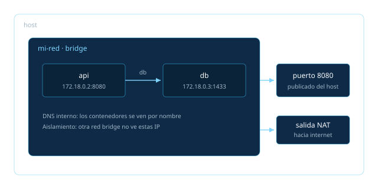

# Redes

Cada contenedor tiene su propio espacio de red. Eso significa que dos contenedores pueden escuchar en el puerto 80 sin chocar, y también que `localhost` dentro de un contenedor apunta a él mismo, nunca al anfitrión. Comunicar contenedores entre sí o con el exterior exige elegir una red y, casi siempre, publicar un puerto.

## Los tipos de red de Docker

| Tipo | Qué ofrece | Cuándo se usa |
|---|---|---|
| `bridge` por defecto | Aislamiento básico, sin DNS | Contenedores sueltos |
| `bridge` propia | DNS por nombre y aislamiento entre redes | Aplicaciones de varios contenedores |
| `host` | Sin aislamiento: comparte la red del anfitrión | Servicios que abren muchos puertos |
| `none` | Sin red | Procesos que no deben comunicarse |
| `overlay` | Red entre varios hosts | Enjambres y orquestadores |
| `macvlan` | IP y MAC propias en la red física | Integración con la red existente |

La red `bridge` por defecto (`docker0`) se crea al instalar el motor. Los contenedores que no indican red caen ahí y solo se comunican por IP, porque esa red **no tiene DNS interno**. Por eso no conviene usarla más allá de pruebas aisladas.

Una red `bridge` creada a mano sí resuelve nombres:

```bash
docker network create mi-red
docker run -d --name web --network mi-red nginx
docker run --rm --network mi-red curlimages/curl http://web
```

Docker monta un DNS en esa red y registra el nombre del contenedor y sus alias. Las redes propias están aisladas entre sí: un contenedor de `mi-red` no ve a uno de `otra-red` salvo que se conecte a ambas. Compose crea una red de este tipo por proyecto, que es la razón de que los servicios se llamen por su nombre.



*La red propia resuelve nombres; la publicación y la salida NAT conectan con el exterior.*

## La red host

```bash
docker run --network host nginx
```

El contenedor no obtiene IP propia y comparte el espacio de puertos del anfitrión. Si el anfitrión ya escucha en el 80, el contenedor no puede hacerlo; si el contenedor lo ocupa, el puerto queda ocupado para el resto. Las publicaciones `-p` se ignoran porque no hay traducción que hacer.

Es útil cuando un servicio abre un rango amplio de puertos y no se quieren mapear uno a uno, o cuando el rendimiento de la pila de red importa. Como contrapartida, desaparece el aislamiento de red. En Linux es nativa; en Docker Desktop se puede activar para contenedores Linux en versiones recientes (macOS 13+ y Windows 11 22H2+) con la opción «Enable host networking».

## Administrar redes

```bash
docker network ls
docker network inspect mi-red
docker network connect mi-red web
docker network disconnect mi-red web
docker network rm mi-red
docker network prune
```

`connect` añade un contenedor en marcha a otra red, útil para diagnosticar sin recrearlo. `rm` falla si hay contenedores conectados. `prune` elimina las redes que no usa nadie; después de matar contenedores de Compose sin `down` es habitual quedarse con redes huérfanas.

## Publicar frente a exponer

`EXPOSE` en el Dockerfile solo documenta. La publicación se hace al ejecutar:

```bash
docker run -d -p 8080:80 nginx
docker run -d -p 127.0.0.1:8080:80 nginx
docker run -d -p 8080:80 -p 8443:443 nginx
```

Sin IP, Docker publica en todas las interfaces (`0.0.0.0`), lo que expone el servicio a la red local y, según el cortafuegos, a internet. Para paneles y bases de datos se usa `127.0.0.1`. El puerto del anfitrión y el del contenedor no tienen por qué coincidir; eso permite tener varios contenedores escuchando en su 80 y publicarlos en 8081, 8082 y 8083.

## Quién ve a quién

| Origen | Destino | Dirección que se usa |
|---|---|---|
| Anfitrión | Contenedor | `localhost:puerto-publicado` |
| Anfitrión | Contenedor sin publicar | IP interna y puerto del contenedor (Linux) |
| Contenedor | Otro contenedor | Nombre de servicio o IP interna, puerto del contenedor |
| Contenedor | Anfitrión | IP del anfitrión o `host.docker.internal` en Desktop |
| Contenedor | Sí mismo | `localhost` |

El puerto publicado es irrelevante desde dentro de la red: un contenedor que llama a otro usa el puerto real, no el del anfitrión. Y en Docker Desktop, la IP interna de un contenedor Linux no es alcanzable desde el sistema anfitrión, porque vive dentro de la máquina virtual.

## Redes en Podman

Podman tiene dos modos y la red cambia con ellos.

En **rootless**, que es el modo por defecto, los contenedores no obtienen IP interna. La conexión sale por un proxy de espacio de usuario —`pasta` en versiones recientes, antes `slirp4netns`— y para alcanzar un contenedor hay que publicar un puerto y usar `localhost`. Dos contenedores rootless se comunican por la IP del anfitrión y el puerto publicado, o compartiendo un pod.

En **root**, Podman usa `netavark` para crear redes `bridge` con IP privada, equivalentes a las de Docker. La red por defecto se llama `podman` y tampoco tiene DNS; una red creada a mano sí lo tiene:

```bash
podman network create mi-red
podman run -d --name web --network mi-red nginx
podman network ls
podman network inspect mi-red
```

Diferencia importante: en Podman, dos redes `bridge` tienen conectividad entre sí por defecto. Para aislarlas hay que crear ambas con `-o isolate=true`; si solo una está aislada, el tráfico sigue pasando. En rootless también se pueden usar redes bridge desde Podman 4, creándolas explícitamente; si no se asigna red, el contenedor usa el proxy sin IP.

`macvlan` da a cada contenedor una MAC y una IP de la red física, lo que lo hace aparecer como un equipo más. Es útil para integrar dispositivos que esperan estar en la misma subred, pero requiere que la red y el conmutador lo permitan.

## Pods y red compartida

Un pod de Podman agrupa contenedores que comparten espacio de red. Todos ven el mismo `localhost`, tienen la misma IP y comparten los puertos: dos contenedores del pod no pueden abrir el mismo puerto. El espacio de red pertenece al pod, así que los puertos se publican al crear el pod:

```bash
podman pod create --name app -p 8080:80
podman run -d --pod app --name web nginx
podman run --rm -it --pod app curlimages/curl http://localhost
```

El pod incluye un contenedor `infra` que mantiene el espacio de nombres aunque los demás estén parados. Los pods son una agrupación lógica, no una máquina: no consumen recursos por sí mismos y no sustituyen a un orquestador.

## Redes en contenedores Windows

Cuando el motor ejecuta contenedores Windows, los tipos cambian:

- **`nat`**: la red por defecto. Los contenedores salen por un conmutador interno de Hyper-V y sí tienen DNS, a diferencia de la bridge de Linux.
- **`transparent`**: el contenedor se conecta a la red física del anfitrión y obtiene una IP de ese segmento, por DHCP o fija.
- **`ics`**: redes ligadas a adaptadores de Hyper-V; un contenedor en ellas es alcanzable desde las máquinas conectadas a ese adaptador.

Las redes de Linux y las de Windows no se mezclan en el mismo motor: al cambiar de modo, los contenedores del otro sistema dejan de verse.

## Exposición y seguridad

Publicar un puerto es abrir una puerta. Las reglas que evitan sustos:

- Publicar solo lo que debe salir y, para administración, en `127.0.0.1`.
- No publicar bases de datos ni el socket del motor.
- Usar una red propia por aplicación, no la bridge por defecto.
- Nombrar servicios en lugar de fijar IP, que cambian.
- Revisar el cortafuegos del anfitrión: Docker inserta sus propias reglas y puede saltarse las que ya existían.

La red de un contenedor no es una frontera de seguridad fuerte por sí sola; es una herramienta de organización y de exposición controlada.
